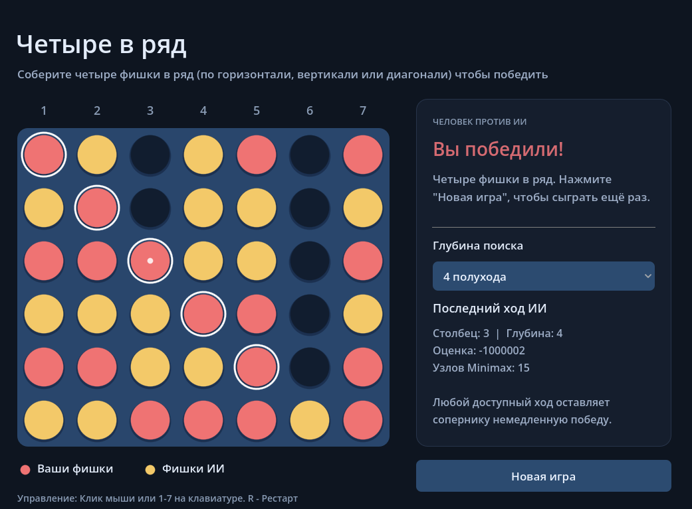
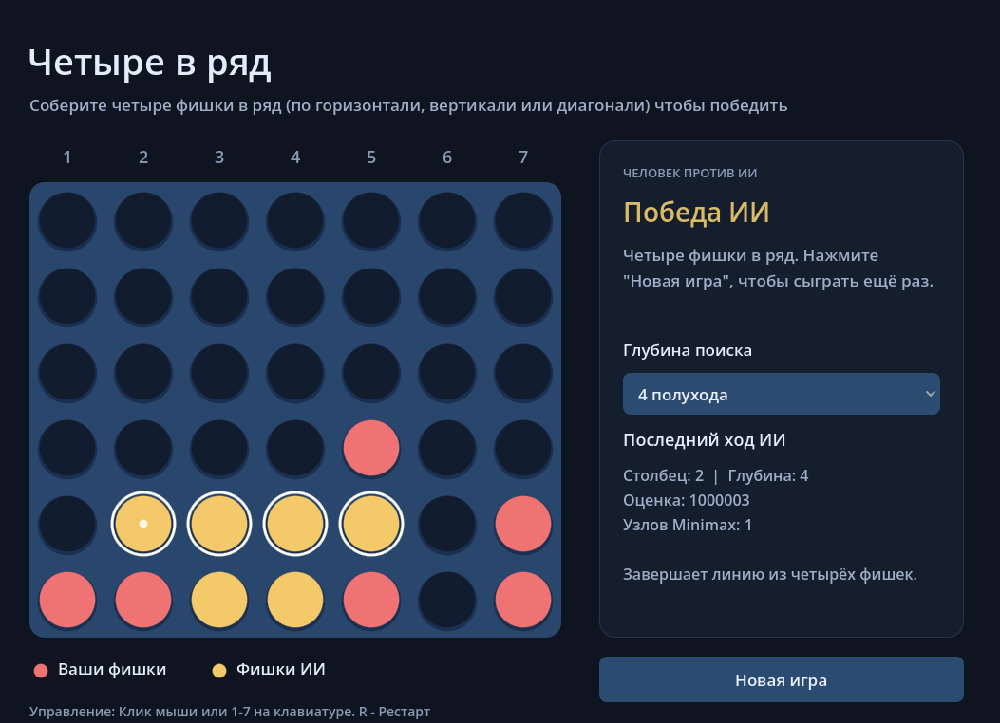

# 2DaiLaba

# Лабораторная работа №2

## Реализация искусственного игрока с использованием алгоритма Minimax

Небольшой 2D-прототип игры "Четыре в ряд", разработанный в Godot на GDScript. Человек играет красными фишками, ИИ - жёлтыми. Для выбора хода ИИ использует Minimax с ограничением глубины и оценкой позиции.

## Цель работы

Цель работы - реализовать искусственного игрока, который рассматривает свои возможные ходы, предполагает ответы противника и выбирает лучший результат при наиболее сильном ответе соперника.

В ходе работы реализованы:

- поле размером 7 на 6 клеток;
- игра человека против ИИ;
- поиск Minimax на глубину от 3 до 5 полуходов;
- эвристическая оценка незавершённых позиций;
- проверка победы, поражения и ничьей;
- блокировка непосредственной угрозы победы противника;
- вывод результата поиска и повторный запуск партии.

## Запуск проекта

[Играть в браузере](https://drunyadv.github.io/2DaiLaba/)

Веб-версия работает без установки Godot, в том числе на телефоне. Для хода достаточно коснуться столбца. При повороте экрана поле и интерфейс перестраиваются, а текущая партия сохраняется.

Для запуска исходного проекта:

1. Установить Godot 4.7 или новее. Проект проверен в Godot 4.7.2
2. Скачать репозиторий и открыть файл `XO/project.godot` через менеджер проектов Godot
3. Дождаться импорта и нажать F5 для запуска проекта или F6 для открытой сцены `scenes/main.tscn`

Для повторного веб-экспорта в проекте сохранён профиль "Web". В Godot нужно установить шаблоны экспорта своей версии и экспортировать этот профиль в `index.html`. Готовая сборка размещена в ветке `gh-pages`, из которой GitHub Pages публикует игру.

## Демонстрация

[Видео игрового процесса](./gameplay.mp4)
[Видео на ютубе](https://www.youtube.com/watch?v=a1BACyXuayE)

### Победа игрока



### Победа ИИ



## Выбранная игра

"Четыре в ряд" - игра для двух участников на вертикальном поле 7 на 6. Игроки по очереди выбирают столбец, а фишка занимает его нижнюю свободную клетку.

Побеждает тот, кто первым соберёт четыре свои фишки подряд по горизонтали, вертикали или диагонали. Если поле заполнено и победной линии нет, партия заканчивается ничьей. В заполненный столбец поставить фишку нельзя.

## Реализация

Проект полностью двумерный. Поле и фишки сделаны стандартными средствами Godot, а интерфейс состоит из обычных элементов Control.

Основные скрипты:

- `scripts/game.gd` - поле, ввод, очерёдность ходов, интерфейс и завершение партии;
- `scripts/minimax.gd` - перебор ходов, Minimax, оценка позиции и проверка линий.

Поле хранится как массив из шести строк по семь клеток. Значение 0 означает пустую клетку, 1 - фишку человека, 2 - фишку ИИ. При поиске очередная фишка временно добавляется на поле, а после расчёта ход отменяется.

## Игрок

Человек ходит первым и управляет красными фишками.

- Щелчок по столбцу или его номеру - поставить фишку.
- Клавиши 1-7 - выбрать соответствующий столбец.
- Кнопка "Новая игра" или клавиша R - начать партию заново.
- Список "Глубина" - выбрать глубину 3, 4 или 5 полуходов для следующего хода ИИ.

При наведении показана клетка, в которую попадёт фишка. Небольшая точка отмечает последний ход. Победная линия выделяется белыми окружностями.

Постановка фишки сопровождается звуком pop. Иногда его высота немного меняется. В браузере звук включается после первого касания или щелчка по игре.

Во время хода ИИ ввод фишек заблокирован. После завершения партии новые ходы не принимаются, но можно начать новую игру.

## Алгоритм Minimax

Из текущей позиции ИИ строит дерево возможных продолжений. Каждый уровень соответствует одной поставленной фишке. Рассматриваются только столбцы, в которых осталось место.

1. ИИ временно делает один из доступных ходов.
2. На следующем уровне рассматриваются возможные ответы человека.
3. Затем снова рассматриваются ходы ИИ, и так до окончания партии или достижения заданной глубины.
4. На уровнях ИИ выбирается максимальная оценка, а на уровнях человека - минимальная.
5. В реальной партии выполняется ход с лучшим итоговым значением.

Рекурсивный перебор реализован в функции `minimax()` из `XO/scripts/minimax.gd`. Для каждой ветки фишка временно ставится на поле, глубина уменьшается на один полуход, а очередь меняется через `not maximizing`. После расчёта ход отменяется:

```gdscript
var row: int = drop_piece(board, column, player)
var score: int = minimax(board, depth - 1, not maximizing, alpha, beta, row, column)
board[row][column] = EMPTY
```

Все оценки считаются с точки зрения ИИ: положительное значение выгодно ему, отрицательное - человеку. Поэтому алгоритм предполагает, что соперник выберет наиболее неприятный для ИИ ответ.

При `maximizing == true` ходит ИИ и выбирается максимум, иначе ходит человек и выбирается минимум. Одновременно обновляются границы альфа-бета:

```gdscript
if maximizing:
	best_score = maxi(best_score, score)
	alpha = maxi(alpha, best_score)
else:
	best_score = mini(best_score, score)
	beta = mini(beta, best_score)
```

Победа ИИ получает оценку `1000000 + оставшаяся глубина`, победа человека - `-1000000 - оставшаяся глубина`, ничья - 0. Прибавка глубины позволяет предпочитать более быструю победу и откладывать неизбежное поражение. Терминальные состояния проверяются до эвристики, даже на последнем уровне поиска.

В начале функции проверяется результат последнего хода, затем наличие доступных столбцов и оставшаяся глубина:

```gdscript
var previous_player: int = HUMAN if maximizing else AI
if is_winning_move(board, last_row, last_column, previous_player):
	return WIN_SCORE + depth if previous_player == AI else -WIN_SCORE - depth

var columns: Array[int] = get_valid_columns(board)
if columns.is_empty():
	return 0
if depth == 0:
	return evaluate_board(board)
```

Для ускорения используется отсечение альфа-бета: ветка больше не рассматривается, если уже понятно, что она не улучшит результат текущего выбора. Максимум и минимум при этом сохраняются. Столбцы перебираются от центрального к краям; при равных оценках остаётся первый найденный ход.

Условие отсечения завершает перебор оставшихся ходов в текущем узле:

```gdscript
if alpha >= beta:
	break
```

### Проверка угроз

Перед основным поиском ИИ проверяет, может ли выиграть одним ходом. Если может, сразу выбирает этот ход.

Затем для каждого своего возможного хода он проверяет все непосредственные ответы человека. Если после хода человек может сразу собрать четыре фишки, такой вариант исключается при наличии безопасной альтернативы. Проверка учитывает и ситуацию, когда новая фишка становится опорой для победного хода противника на строку выше.

Если безопасных ходов нет, ИИ всё равно выбирает ход через Minimax. В такой позиции избежать немедленного поражения уже невозможно.

## Оценочная функция

Если партия ещё не закончилась, а глубина исчерпана, оцениваются все отрезки по четыре клетки в четырёх направлениях. Всего на поле 69 таких отрезков.

| Содержимое отрезка                       | Оценка |
| ---------------------------------------- | -----: |
| 3 фишки ИИ и 1 пустая клетка             |   +100 |
| 2 фишки ИИ и 2 пустые клетки             |    +10 |
| 3 фишки человека и 1 пустая клетка       |   -140 |
| 2 фишки человека и 2 пустые клетки       |    -12 |
| Фишки обоих игроков или остальные случаи |      0 |

Дополнительно каждая фишка ИИ в центральном столбце добавляет 6 очков, а каждая фишка человека в нём вычитает 6 очков. Через центр проходит больше потенциальных линий.

Отрезки с фишками обоих игроков уже нельзя заполнить одной стороной, поэтому они не дают очков. Угрозы человека имеют немного больший вес, чтобы ИИ учитывал необходимость защиты. Эвристика оценивает потенциальные линии, а возможность немедленно поставить фишку и выиграть проверяется отдельно по правилам падения фишек.

## Пример хода ИИ

Пусть перед ходом ИИ поле выглядит так. Строки показаны сверху вниз, столбцы пронумерованы слева направо. `Ч` - человек, `И` - ИИ, `.` - пустая клетка.

```text
1 2 3 4 5 6 7
. . . . . . .
. . . . . . .
. . . . . . .
. . . . . . .
. . . . . . .
Ч Ч Ч . И И .
```

Человек угрожает поставить фишку в столбец 4 и получить горизонтальную линию из четырёх фишек. Собственного немедленного выигрыша у ИИ нет. Если ИИ выберет любой другой столбец, человек выиграет следующим ходом.

Поэтому ИИ ставит фишку в столбец 4 и блокирует угрозу:

```text
Ч Ч Ч И И И .
```

На этой позиции при глубине 4 программа выбирает столбец 4, получает итоговую оценку 4 и посещает 287 узлов Minimax. Это оценка лучшего продолжения после ответов человека, а не только поля сразу после поставленной фишки. Проверки непосредственных угроз в число узлов Minimax не включены.

В интерфейсе после каждого хода выводятся выбранный столбец, глубина, оценка, число узлов и краткая причина выбора.

## Ограничение глубины поиска

По умолчанию используется глубина 4 полухода: ход ИИ, ответ человека, следующий ход ИИ и следующий ответ человека. В интерфейсе можно выбрать от 3 до 5 полуходов.

На одном уровне может быть до семи продолжений. Без отсечений на глубине 5 получается до `7^5 = 16807` конечных ветвей. При попытке просчитать всю партию дерево становится слишком большим.

Ограничение глубины сохраняет небольшое время ожидания хода, а оценочная функция помогает сравнивать незавершённые позиции. При этом ИИ не гарантирует идеальную игру: угрозы за пределами глубины могут остаться незамеченными.

## Итог

Создана 2D-игра "Четыре в ряд", в которой человек играет против ИИ. Искусственный игрок перебирает продолжения через Minimax, учитывает ответы соперника, использует эвристику на заданной глубине и проверяет непосредственные угрозы. Реализованы все направления победы, ничья, запрет хода в заполненный столбец и повторный запуск партии.

## Использованные технологии

- Godot 4 - игровой движок с языком программирования gdscript
- Control и стандартные элементы интерфейса Godot
- Minimax с отсечением альфа-бета - выбор хода ИИ
